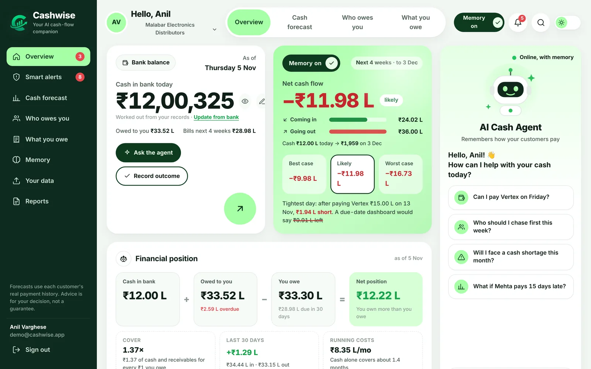
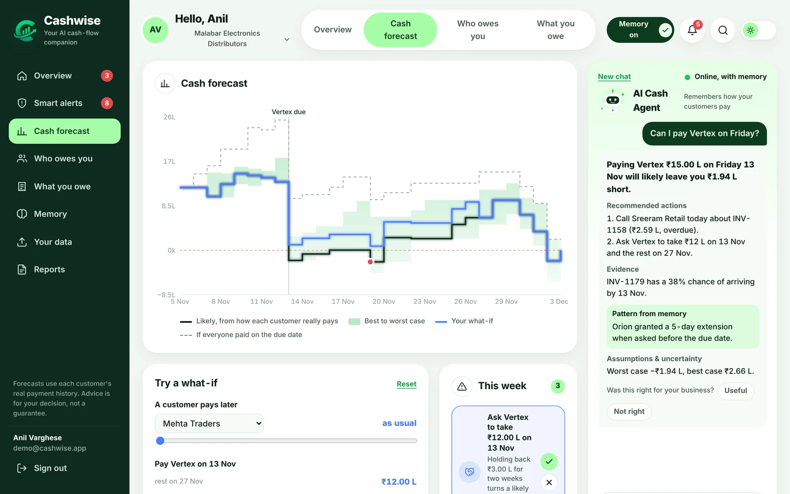
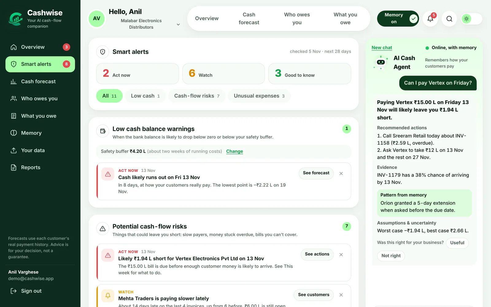
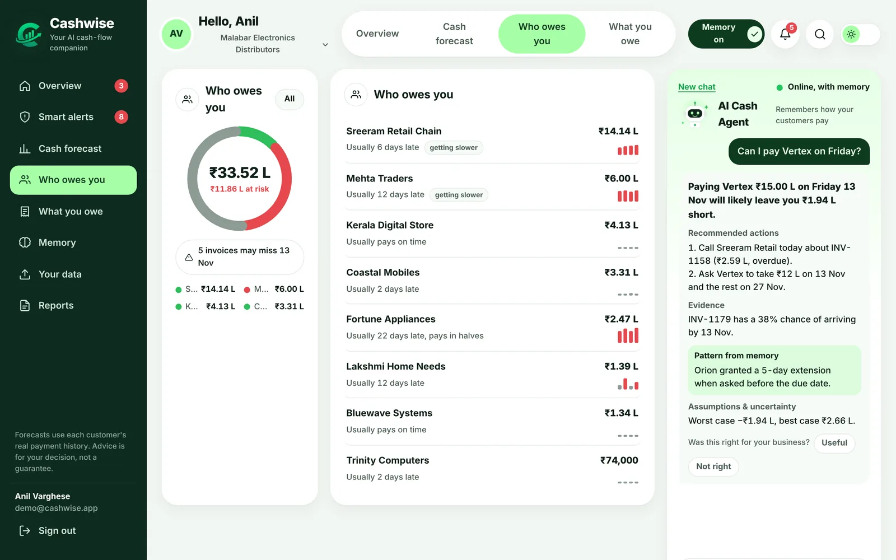
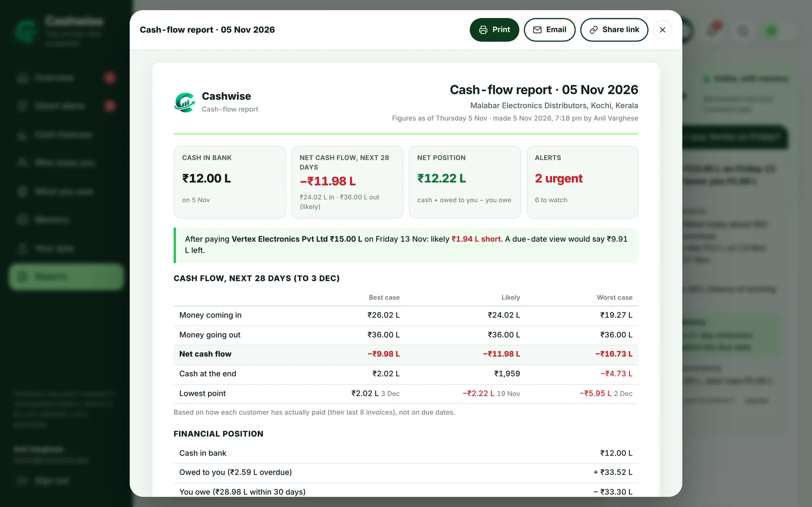
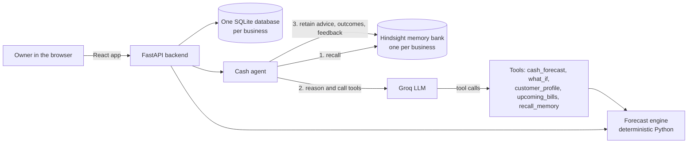

<div align="center">

<picture>
  <source media="(prefers-color-scheme: dark)" srcset="frontend/public/logo-dark.png">
  
</picture>

# Cashwise

**Know if you can pay next week's bills, before the week starts.**

An AI cash-flow companion for small businesses. It learns how each customer *really* pays, forecasts cash in
best, likely and worst cases, and remembers what worked last time, using [Hindsight](https://vectorize.io) memory.

[**Live demo**](https://cashwise-5c6z.onrender.com) · [Features](#features) · [How it works](#how-it-works) ·
[Run it locally](#run-it-locally) · [Deploy](#deploy-on-render)

Built for **HackwithHyderabad 3.0**, the Hindsight AI-agent memory hackathon.

</div>

<picture>
  <source media="(prefers-color-scheme: dark)" srcset="frontend/public/shots/overview-dark.webp">
  
</picture>

---

## The problem

Most cash dashboards assume every invoice is paid on its due date. In real life, some customers are always a week
or two late, and small business owners find out on the day the big supplier bill is due.

**The demo business shows the difference.** Malabar Electronics has ₹12.00 L in the bank and owes a supplier
₹15 L on Friday 13 Nov.

| | After paying the supplier |
|---|---|
| A due-date dashboard says | **₹9.91 L left** |
| Cashwise says (likely, from how each customer really pays) | **₹1.94 L short** |
| Cashwise's suggestion: ask the supplier to take ₹12 L now, the rest in two weeks | **₹1.06 L left** |

## Try it

Open **https://cashwise-5c6z.onrender.com** and click **Try the live demo**, or sign in with:

```
Email:    demo@cashwise.app
Password: demo1234
```

The demo runs on Render's free plan, so the first visit after a quiet spell can take about 50 seconds to wake up.
The demo business is shared and reset from time to time, so please don't put real data in it.

## Who it's for

- **Wholesalers and distributors** who sell to shops on 30 to 60 days' credit
- **Manufacturers and traders** whose raw-material bills arrive before customer money does
- **Service businesses** that invoice monthly and pay salaries and rent on time
- **Accountants and finance managers** who report cash every week
- **Owners with more than one business**: each keeps its own records and memory

## Features

### Know your cash
- **Net cash flow** for the next 4 weeks: money in, money out and the difference, in best, likely and worst cases
- **Bank balance from your bank**: type in what the bank shows, and one adjustment keeps the books in line
- **Financial position**: cash + owed to you − you owe, with cover, the last 30 days and cash runway
- **Cash forecast chart**: day by day, with the range of outcomes and the due-date line for comparison

### Act on it
- **This week**: a short to-do list worked out from the forecast (who to chase, what to negotiate)
- **What-if**: move a customer's payment, split a bill or speed up collections, and watch the line redraw
- **Smart alerts**: low cash warnings, cash-flow risks (slow payers, money stuck overdue, one customer owing too much)
  and unusual expenses (spikes, new costs, heavy months), sorted by urgency
- **Notifications** in one place, cleared once seen

### An AI agent with memory
- Ask in plain words: *"Can I pay Vertex on Friday?"*, *"Who should I chase first?"*, *"What if Mehta pays 15 days late?"*
- Answers quote the forecast's numbers, with recommended actions, evidence, patterns from memory, and uncertainty
- Record outcomes and give feedback, and they're remembered for next time
- Switch memory off to compare with a plain due-date assistant

### Reports for management
- **Print or save as PDF** straight from the website, on clean A4 pages
- **Email** to a management list, now or on a **weekly or monthly schedule**
- **Read-only share links** that can't be guessed, expire, and can be turned off
- **Compare two periods** (money in and out, invoicing, days late, expenses by category)
- **Report history** and an **audit trail** of every financial change and report action

### Your data, your way
- **CSV uploads** from Tally, Zoho Books, QuickBooks or Excel, with templates; Indian dates and ₹ amounts are understood
- Every row is checked before anything is saved, with row-by-row errors
- **Several businesses** per account, each in its own database
- **Sign in** with email, Google or GitHub (Apple supported in the code)
- Light and dark themes, and it works on phones

<table>
  <tr>
    <td width="50%"><br><sub><b>Cash forecast</b>: best to worst range, what-if line, and the agent's answer</sub></td>
    <td width="50%"><br><sub><b>Smart alerts</b>: low cash, cash-flow risks and unusual expenses</sub></td>
  </tr>
  <tr>
    <td width="50%"><br><sub><b>Who owes you</b>: each customer's real payment habits</sub></td>
    <td width="50%"><br><sub><b>Reports</b>: print, email, schedule or share</sub></td>
  </tr>
</table>

## What's different

| A usual cash dashboard | Cashwise |
|---|---|
| Assumes every customer pays on the due date | Learns how each customer really pays from their last 8 invoices |
| One number, as if the future were certain | Best case, likely and worst case, side by side |
| Forgets what happened last time | Remembers what worked, using Hindsight memory |
| AI that can make up figures | The AI never does the maths: every number comes from the forecast engine |
| Tells you on the day | Warns you weeks ahead, with a short list of what to do |

## How it works



### The forecast (no AI involved)
1. For every customer, Cashwise looks at their **last 8 paid invoices** and measures how many days late each was.
2. The **20th, 50th and 90th percentile** of those delays give the **best**, **likely** and **worst** case for when each
   open invoice will actually arrive.
3. Supplier bills, recurring expenses (rent, salaries) and any what-if changes are added day by day, starting from
   the real bank balance.
4. Alerts, net cash flow, the financial position and reports are all worked out from this, so every figure can be traced.

### The agent, with Hindsight memory
For each question the agent:
1. **Recalls** the most relevant memories from this business's own Hindsight bank (calls, disputes, deals and outcomes).
2. **Reasons** with the Groq LLM, which decides which deterministic tools to call.
3. **Computes**: Python tools return forecasts and what-ifs. The LLM never does the arithmetic.
4. **Explains**: the answer, recommended actions, evidence, patterns from memory, assumptions and uncertainty.
5. **Retains** the recommendation, so outcomes and feedback the owner records later are linked to it.

Each business gets its **own memory bank**. Uploaded history notes are retained in batches, and every outcome or
correction the owner records is retained too, so advice gets more specific over time.

## Tech stack

| Part | Built with |
|---|---|
| Frontend | React 18, Vite, Recharts, plain CSS (light and dark themes) |
| Backend | Python 3.12, FastAPI, SQLAlchemy 2, Uvicorn |
| AI | Groq (`openai/gpt-oss-120b` by default) with tool calling |
| Memory | Hindsight by Vectorize (`hindsight-client`) |
| Auth | Email and password (PBKDF2-SHA256), JWT sessions, Google and GitHub OAuth |
| Storage | SQLite: one platform database, plus one database per business |
| Hosting | Docker on Render |

## Project structure

```
Cashwise/
├── app/
│   ├── main.py            # creates the app, starts the report scheduler, serves the built site
│   ├── core/              # settings, security, errors, logging, money formatting
│   ├── db/                # platform tables (users, businesses) and per-business tables
│   ├── routes/            # API: auth, businesses, dashboard, agent, data, reports
│   └── services/          # forecast, insights, alerts, reports, agent, tools, memory, ingest, oauth, mailer, scheduler
├── data/                  # the Malabar Electronics demo data (CSV)
├── scripts/               # load_memory.py, ask.py, reset_demo.py
├── tests/                 # pytest suite
├── frontend/
│   ├── src/               # React app: overview page, sign-in, dashboard, reports, legal pages
│   └── public/            # logo, favicon, screenshots
├── Dockerfile             # builds the frontend, then runs the backend
├── render.yaml            # Render blueprint
├── DEPLOY.md              # step-by-step deployment guide
└── BACKEND.md             # backend details and sign-in provider setup
```

## Run it locally

You need **Python 3.11+**, **Node.js 20+**, a [Groq API key](https://console.groq.com/keys), and a Hindsight API key.

**1. Backend** (from the project folder):

```bash
python -m venv venv
venv\Scripts\activate            # Windows (on macOS or Linux: source venv/bin/activate)
pip install -r requirements.txt
copy .env.example .env           # macOS or Linux: cp .env.example .env
```

Put your keys in `.env`:

```
GROQ_API_KEY=gsk_...
HINDSIGHT_API_KEY=hsk_...
HINDSIGHT_URL=https://api.hindsight.vectorize.io
```

Load the demo business's history into memory (once), then start the API:

```bash
python -m scripts.load_memory
uvicorn app.main:app --reload
```

**2. Frontend** (in a second terminal):

```bash
cd frontend
npm install
npm run dev
```

Open **http://localhost:5173**. The dev server forwards `/api` to the backend on port 8000, and the API docs are at
http://localhost:8000/docs.

**3. Tests:**

```bash
pip install -r requirements-dev.txt
pytest
```

The tests use a throwaway database and never call Groq or Hindsight.

## Configuration

All settings come from environment variables, or from `.env` when running locally. Never commit `.env`.

| Variable | Required | What it's for |
|---|---|---|
| `GROQ_API_KEY` | yes | The AI agent |
| `HINDSIGHT_API_KEY` | yes | Long-term memory |
| `HINDSIGHT_URL` | | Defaults to `https://api.hindsight.vectorize.io` |
| `HINDSIGHT_BANK_ID` | | The demo business's memory bank (`malabar-electronics`) |
| `JWT_SECRET` | in production | Signs sign-in tokens; Render generates one |
| `APP_URL` | | The site's public address; on Render it's detected automatically |
| `GOOGLE_CLIENT_ID`, `GOOGLE_CLIENT_SECRET` | | Sign in with Google |
| `GITHUB_CLIENT_ID`, `GITHUB_CLIENT_SECRET` | | Sign in with GitHub |
| `SMTP_HOST`, `SMTP_PORT`, `SMTP_USER`, `SMTP_PASSWORD`, `SMTP_FROM` | | Emailing reports (any SMTP server, e.g. Gmail with an app password) |
| `REPORT_TZ` | | Time zone for scheduled reports (default `Asia/Kolkata`) |
| `CASHWISE_STORAGE` | | Where the databases are kept (default `storage/`) |
| `SEED_DEMO` | | Create the demo account on start (default on) |
| `GROQ_MODEL` | | Defaults to `openai/gpt-oss-120b` |

## Using your own data

Sign up, open **Your data**, and upload one CSV per type, in this order. Each has a downloadable template.

| # | File | Required columns |
|---|---|---|
| 1 | Customers | `customer_id`, `name` |
| 2 | Sales invoices | `invoice_id`, `customer_id`, `issue_date`, `amount` |
| 3 | Payments received | `date`, `amount` (link with `invoice_id`) |
| 4 | Suppliers | `supplier_id`, `name` |
| 5 | Supplier bills | `bill_id`, `supplier_id`, `bill_date`, `amount` |
| 6 | Payments made | `date`, `amount` (link with `bill_id`) |
| 7 | Expenses | `date`, `category`, `amount` (`recurring`: Monthly, Variable, Yearly or No) |
| 8 | History for memory | `date`, `entity_type`, `event_type`, `description` (sent to Hindsight) |

Dates like `2026-11-05` or `05/11/2026` and amounts like `₹3,30,000` both work. If any row is wrong, nothing is
saved and you're told which row and why. Include a few months of past invoices and payments so Cashwise can learn
each customer's habits.

## Deploy on Render

The repo includes a `Dockerfile` and a `render.yaml` blueprint:

1. Push the repo to GitHub.
2. In Render, choose **New → Blueprint** and pick the repo.
3. Paste `GROQ_API_KEY` and `HINDSIGHT_API_KEY` when asked, then click **Apply**.
4. When it's live, check `https://<your-app>.onrender.com/api/health` shows `ai_configured` and `memory_configured` as `true`.

For Google and GitHub sign-in, register these callback addresses with each provider, then add the client IDs and
secrets in Render's Environment settings:

```
https://<your-app>.onrender.com/api/auth/oauth/google/callback
https://<your-app>.onrender.com/api/auth/oauth/github/callback
```

On the free plan the disk resets when the service restarts: the demo business rebuilds itself, and memories in
Hindsight are kept, but uploaded data and email accounts are lost. Add a persistent disk (paid plan) to keep them.
Full steps, including email setup, are in [DEPLOY.md](DEPLOY.md).

## API overview

Interactive docs are at `/docs` on any running server. Every business route needs `Authorization: Bearer <token>`
and `X-Business-Id: <id>`.

| Area | Endpoints |
|---|---|
| Auth | `POST /api/auth/register`, `POST /api/auth/login`, `GET /api/auth/me`, `GET /api/auth/providers`, `GET /api/auth/oauth/{provider}/start` |
| Businesses | `GET/POST /api/businesses`, `GET/PUT/DELETE /api/business` |
| Dashboard | `GET /api/forecast`, `/position`, `/alerts`, `/actions`, `/customers`, `/bills`, `/timeline`; `POST /api/scenario` |
| Agent | `POST /api/ask`, `POST /api/feedback`, `POST /api/outcome`, `GET /api/memories` |
| Data | `GET /api/data/types`, `GET /api/data/templates/{kind}`, `POST /api/data/upload/{kind}`, `DELETE /api/data/{kind}`, `POST /api/data/demo`, `POST /api/data/sync-memory` |
| Reports | `GET/POST /api/reports`, `POST /api/reports/{id}/email`, `POST /api/reports/{id}/share`, `GET /api/shares`, `GET/POST /api/schedules`, `GET /api/audit`, `GET /api/public/reports/{token}` |

## Privacy and safety

- Each business has its own separate database, so one business can never see another's records.
- Passwords are stored only as PBKDF2-SHA256 hashes, and sign-in tokens expire.
- Shared report links show a single report, can expire, and can be turned off at any time.
- Every financial change and report action is written to an audit trail.
- See the in-app [privacy policy](https://cashwise-5c6z.onrender.com/privacy) and [terms](https://cashwise-5c6z.onrender.com/terms).

> Cashwise gives cash-flow insights to help you decide. Forecasts are estimates based on past payment habits and
> are **not financial advice**.

---

<div align="center">
Built by Gautham Krishna for HackwithHyderabad 3.0 · Memory by <a href="https://vectorize.io">Hindsight</a> · AI by <a href="https://groq.com">Groq</a>
</div>
