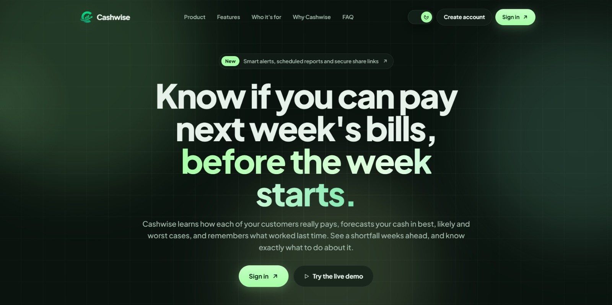
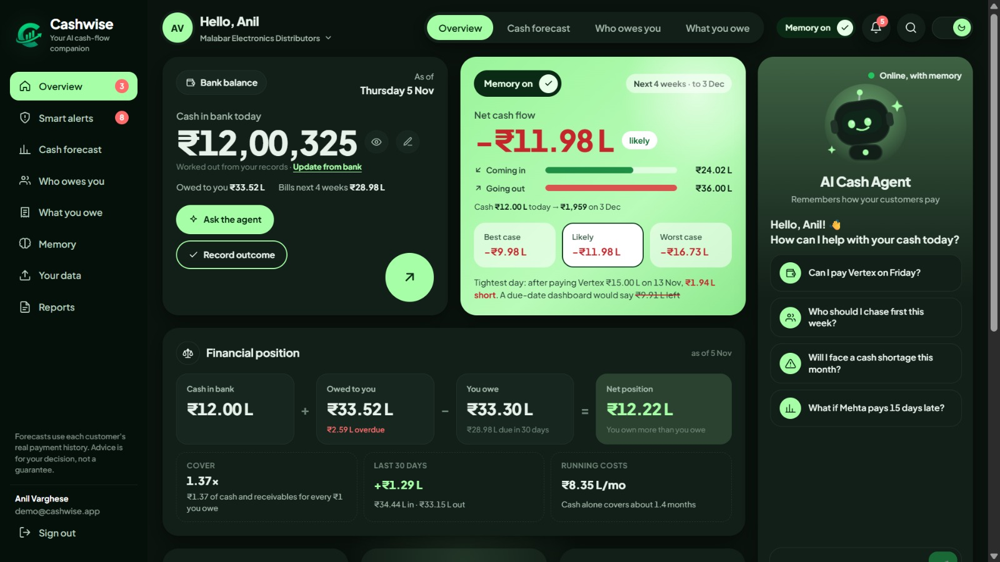
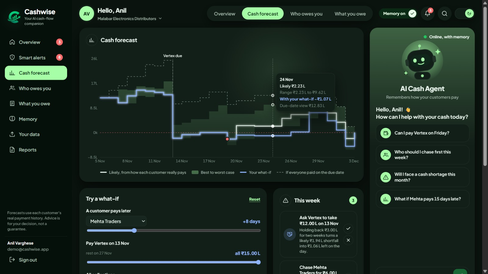
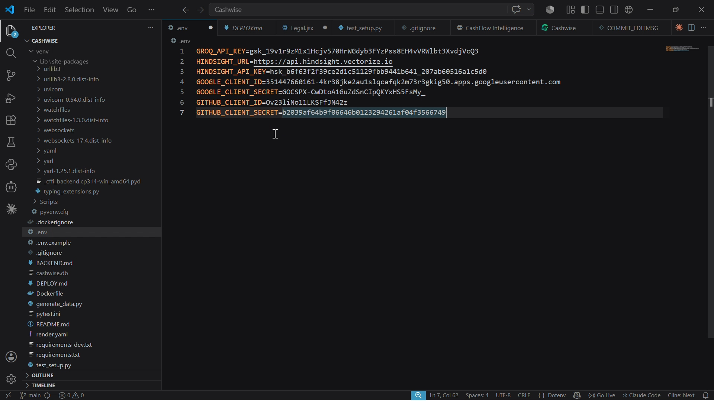

A Dashboard Said ₹9.91L Left; My Hindsight Agent
Disagreed
An electronics distributor had ₹12.00 L in the bank and a ₹15 L supplier bill due on Friday. Every cash
dashboard I tried said the same thing: pay it, and ₹9.91 L is still there. The forecast I built from the same
records said the account would end ₹1.94 L short. (A lakh, "L", is 100,000 rupees.)
Neither number was a bug. They disagreed because they assumed different things about when
customers pay. This post is about how I built the system that surfaces that disagreement, and about the
decision I'm happiest with: Python owns every number, and Hindsight owns every reason.
What I built and how it hangs together
Cashwise is a cash-flow assistant for small businesses that sell on credit: wholesalers, distributors,
traders. Owners upload CSVs from Tally, Zoho Books, QuickBooks or Excel: customers, invoices,
payments received, suppliers, bills, payments made, expenses, and a free-text "history" file of what
happened and what worked. From that, the system produces a four-week cash forecast, alerts, a
weekly to-do list, shareable reports, and an agent you can ask things like "Can I pay Vertex on Friday?"
The pieces:
Backend: FastAPI and SQLAlchemy. Every business gets its own database, so one business can't
see another's rows even through a bad query.
Frontend: React and Vite, with Recharts for the forecast chart.
Forecast engine: plain, deterministic Python. No model involved.
Agent: an open model on Groq ( openai/gpt-oss-120b by default) with tool calling.
Memory: one Hindsight memory bank per business.
The request path for a question is short: recall relevant memories, let the model decide which tools to
call, run those tools in Python, answer, then retain the recommendation so later outcomes can be tied
back to it.
The through-line: two kinds of knowledge
Cash forecasting mixes two problems that look similar and aren't.
1. When will this money arrive? This is statistics. You have a customer's past payment delays, and
you want a distribution.
2. Why, and what do we do about it? This is narrative. Mehta Traders pays late and ignored twelve
email reminders and answered a phone call two days after the due date. The owner declined an overdraft and wants rent paid on time, always.
My first instinct was to give the model everything and let it reason. I dropped that quickly. A model that
estimates cash positions in its head will produce confident rupee figures that nobody can trace. And a
statistics engine has no place to put "the landlord charged a ₹6,000 late fee and the owner said never
again."
So the split is strict. The forecast engine answers question 1 and nothing else. Hindsight answers
question 2 and nothing else. The model sits between them, picking tools and writing the explanation.
The forecast: percentiles, conditioned on "not paid yet"
For each customer, I take the last eight paid invoices and measure how many days late each one was.
The 20th, 50th and 90th percentiles of those delays become the best, likely and worst cases for every
open invoice.
HISTORY_WINDOW = 8 # recent paid invoices per customer used as evidence
SCENARIOS = {"best": 0.2, "likely": 0.5, "worst": 0.9}
The detail that mattered most is conditioning. If an invoice is already 10 days overdue, a past payment
that arrived 3 days late tells you nothing, because it can't have happened to this invoice. So only history
that is consistent with "not paid yet" is allowed to vote:
# Only past behaviour consistent with "not paid yet" is relevant (conditioning).
cands = sorted((h for h in recent if h["final_delay"] > elapsed),
 key=lambda h: h["final_delay"])
...
h = self._q(cands, q)
Part-payments are handled the same way. Each historical invoice keeps its list of (delay_days,
fraction_of_amount) parts, so a customer who always pays in two halves is forecast as two cash
events, not one lump. If nothing in the history is later than where the invoice already is, the engine says
so and assumes 2 to 14 more days, and the basis string it returns says that in plain words.
The "dashboard" view in the same function is just use_history=False : every open invoice paid exactly
on its due date. That one flag is where the ₹9.91 L comes from. The history-based "likely" case is where
₹1.94 L short comes from. Same data, one assumption flipped.
Keeping the model away from arithmetic
The system prompt has a hard rule: never calculate, add up or estimate money; every number must
come from a tool result. A rule alone isn't enough, so the tool layer does the formatting too. Indian rupee
notation (lakhs, not millions) is exactly the kind of thing a model will quietly get wrong, so every money
field is returned with a pre-formatted twin: def _add_text(d: dict) -> dict:
 """Add pre-formatted rupee strings so the LLM never converts numbers itself."""
 out = {}
 for k, v in d.items():
 out[k] = v
 if isinstance(v, int) and any(w in k for w in ("balance", "cash", "lowest",
"end", "before",
 "after", "outstanding",
"amount", "target")):
 out[k + "_text"] = inr(v)
 return out
inr() turns -194000 into -Rs 1.94 L . The prompt tells the model to prefer the *_text fields. It isn't
a guarantee, but it moves the failure mode from "model converted units wrong" to "model ignored an
instruction," which is a much smaller surface to watch.
The same idea applies to what-ifs. The model never simulates a scenario. It emits a structured change
( split_bill , delay_customer , extend_bill , customer_pays_on , and a few others), and
simulate() runs the baseline and the changed forecast side by side. It also accepts names ("Mehta",
"Vertex") and resolves them to ids, because models write names and databases want ids.
What goes into Hindsight, and why it's a separate system
Hindsight is an open-source agent memory system. I use three things from it: a bank per business,
retain for writing, and recall for reading. If you want the concepts behind that, Vectorize's explainer
on what agent memory is is a good starting point, and the Hindsight documentation covers the API.
One bank per business. The bank is created with a mission built from the business's name, industry
and city:
Remember how each customer pays (delays, part-payments, seasonal patterns), which collection
approaches worked, supplier terms, extensions and penalties, past cash crunches, and the owner's
decisions and preferences, with their outcomes.
That sentence is the schema. I didn't design a table for "collection attempts" or "owner preferences". I
wrote down what a good bookkeeper would remember and let the memory layer organize it.
History is retained as sentences, with metadata. Each uploaded history row becomes one memory:
text = f"On {d} ({e['entity_type']} {who}): {e['description']}"
if e.get("outcome"):
 text += f" Outcome: {e['outcome']}"
items.append({"content": text, "timestamp": f"{d}T10:00:00Z",
 "context": f"{e['event_type'].replace('_', ' ')} for {who}",
 "document_id": f"event-{e['event_id']}", "tags": [f"{e['entity_type']}:{e['entity_id']}", e["event_type"]],
...})
Two choices here paid off. The document_id is derived from the event id, so re-sending a history file
updates memories instead of stacking duplicates, which matters because owners re-upload exports
constantly. And the real date goes in as the timestamp, so a call made in April is remembered as April,
not as "whenever the upload ran."
Everything the agent does is also retained. After each answer, the question and the recommendation
are stored with a recommendation tag. When the owner later records what actually happened
( outcome ) or says the advice was wrong ( feedback ), those are retained too, as dated statements
("Follow this in future recommendations"). The loop closes: advice, outcome, correction, next advice.
Recall happens before the model speaks. I don't wait for the model to decide it needs memory. Each
question triggers two recalls up front, one on the question itself and one on a standing query about
owner preferences:
for q in (question, "owner preferences, decisions and feedback about cash, loans,
rent and suppliers"):
 try:
 for m in self.memory.recall(q)[:6]:
The second query exists because of one failure I could see coming: a question about a supplier payment
doesn't mention overdrafts, but the owner's rejection of one is exactly what should stop the agent from
suggesting it. The prompt then says to use the memories to personalize advice and never recommend
something the owner has rejected. There is also a recall_memory tool for follow-up lookups mid-
answer.
What the agent actually says
The prompt fixes the answer format: answer, up to three recommended actions, evidence, patterns
from memory, and assumptions with the range. Here is the shape of a reply to "Can I pay the ₹15 L
supplier bill on Friday?", condensed. The figures are the ones the forecast engine produces for this
business:
Answer: Paying in full on Fri 13 Nov leaves the account Rs 1.94 L short in the
likely case.
Recommended actions:
1. Ask the supplier to take Rs 12 L on Friday and the rest in two weeks.
 (what_if: Rs 1.06 L left in the likely case)
2. Phone Mehta Traders 2 days after each due date instead of emailing.
3. ...
Evidence: open invoice ids and each customer's last-8 delay history.
Pattern from memory: Email reminders to Mehta got no reply across a dozen
invoices. Calls 2 days after the due date got payment in 4 to 7 days late until September, when four calls in a row did not (festival stock pressure,
13 to 15 days late).
Assumptions & uncertainty: best to worst range; new sales not collected in
this window.
The memory line is the part no dashboard can produce. The delays come from the percentile engine,
but "calls worked, until they stopped working in September, and here's the stated reason" comes from
retained events with outcomes. Same for supplier negotiation: one supplier granted a 5-day extension
by phone when asked before the due date, another charged a 1.5% late fee and doesn't give extensions.
Which supplier you ask for a split matters, and that's a fact about a relationship, not a number.
There is also a memory-off mode, use_memory=False . It runs the same agent with only the naive due-
date forecast and two tools, no history and no recall. I keep it as a control. When I want to know what
memory adds to an answer, I can ask the same question both ways.
What was painful
Malformed tool calls. Open models sometimes emit broken tool-call JSON. The loop retries with a
corrective system message, and if that still fails it computes the forecast itself and asks the model
for a plain-text answer from that result. It's ugly and necessary.
Rate limits and flaky networks. Hindsight calls go through a three-attempt retry with a growing
sleep. Groq rate limits get their own retry path.
Memory is eventually consistent. After a history upload, processing takes a minute or two. The
API says so in its response. Anything you retain and immediately recall may not be there yet, so I
never build a flow that depends on read-your-writes.
Lessons I'd reuse
1. Split by kind of knowledge, not by feature. Quantities and timing belong in code you can unit-test.
Context, preferences and "what worked" belong in memory. Putting either in the wrong place gives
you untraceable numbers or amnesiac advice.
2. Pre-format values the model will repeat. If a unit convention can go wrong, remove the
conversion from the model's job.
3. Condition on what you already know. The "not paid yet" filter changed the forecast more than any
tuning of percentiles or window size.
4. Treat memory as best-effort on the write path. Saves run asynchronously and failures are
logged, not raised. Uploading history without Hindsight configured still saves the records. The
agent's tests run against a stand-in model, with no keys.
5. Keep a memory-off control. A flag that disables recall is the cheapest way to check that memory is
doing something real. The ₹1.94 L shortfall never showed up on a due-date dashboard, because a dashboard has no idea
what Mehta did the last twelve times. I'd rather have the argument on Monday than discover it on Friday.

## About CashWise

CashWise is an AI-powered personal finance management platform designed to help people track expenses, understand spending habits, and make smarter financial decisions.

## Application Screenshots

### 1. Homepage

### 2. Dashboard

### 3. Features

### 4. Financial Insights

